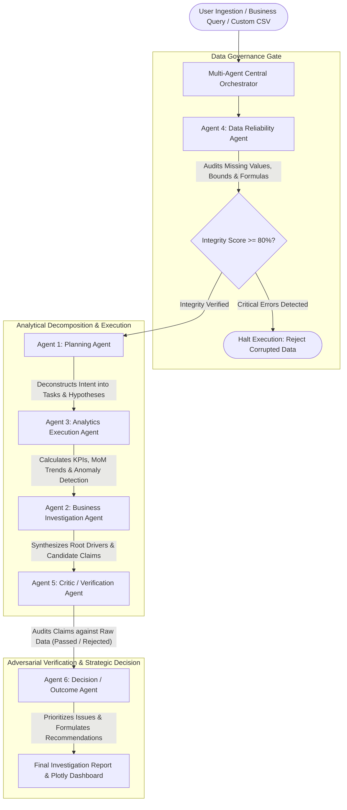

# AnalystOS — Multi-Agent AI Business Investigation System

> **A placement-quality, production-ready, autonomous multi-agent business intelligence system designed for e-commerce root-cause diagnosis, adversarial evidence verification, and strategic outcome planning.**

---

## 1. Project Overview

**AnalystOS** is a modular multi-agent analytics platform that solves one of the hardest challenges in enterprise data intelligence: **moving from passive dashboards to active, automated, evidence-backed business investigations.**

Unlike traditional BI dashboards that merely present static graphs and leave diagnosis to manual guesswork, AnalystOS coordinates **six specialized analytical agents** orchestrated in a verifiable workflow. When presented with complex inquiries—such as *"Why did our profits decrease, which products or regions contributed most, and what actions should we take?"*—the system investigates the underlying transaction data, uncovers hidden margin compression patterns, adversarially audits every numerical claim against raw facts, and formulates prioritized, actionable strategic recommendations.

---

## 2. Problem Statement & Motivation

Modern e-commerce enterprises face severe data complexity:
1. **"Profitless Growth" Blindspots:** Top-line revenue frequently increases due to holiday volumes while net profitability collapses due to supplier cost surges and promotional discounting.
2. **Dashboard Fatigue:** Standard business intelligence dashboards show *what* happened (e.g., sales charts) but fail to explain *why* it happened or *what to do next*.
3. **Hallucination & Analytical Trust:** Generative LLM solutions often hallucinate numerical values, invent phantom trends, or provide vague advice not grounded in the underlying math.
4. **Data Governance & Integrity:** Real-world datasets often suffer from broken formulas, corrupted dates, or negative prices that pollute strategic decisions.

AnalystOS solves this by implementing **deterministic, tool-using analytical agents** coupled with an **adversarial verification critic** that rejects any claim not mathematically proven from source data.

---

## 3. System Architecture & Multi-Agent Workflow



---

## 4. The Six Specialized Agents

Each agent has a dedicated module, explicit input/output contracts, and non-overlapping responsibilities:

| Agent | Module | Core Responsibility | Key Inputs & Outputs |
| :--- | :--- | :--- | :--- |
| **Agent 1: Planning Agent** | `agents/planning_agent.py` | Deconstructs user business query into measurable metrics, dimensions, tasks, and hypotheses. | **In:** Natural language query<br>**Out:** `InvestigationPlan` |
| **Agent 2: Business Investigation Agent** | `agents/investigation_agent.py` | Synthesizes multi-dimensional patterns, identifies primary margin compression drivers, and generates candidate claims. | **In:** Plan, Analytics Results<br>**Out:** `InvestigationFindings` |
| **Agent 3: Analytics Execution Agent** | `agents/analytics_agent.py` | Executes deterministic statistical formulas: enterprise KPIs, MoM trends, category/region/product analytics. | **In:** Clean DataFrame<br>**Out:** `AnalyticsExecutionResult` |
| **Agent 4: Data Reliability Agent** | `agents/reliability_agent.py` | Non-destructive data quality gate: verifies formula consistency, schema, missingness, duplicate keys, and bounds. | **In:** Raw DataFrame<br>**Out:** `DataReliabilityReport` |
| **Agent 5: Critic / Verification Agent** | `agents/critic_agent.py` | Adversarial auditor: tests each candidate claim against raw source records, scoring verification rate and rejecting unbacked claims. | **In:** DataFrame, Findings<br>**Out:** `VerificationReport` |
| **Agent 6: Decision / Outcome Agent** | `agents/decision_agent.py` | Strategic intelligence: prioritizes issues by dollar impact, formulates actionable playbooks, and separates facts from hypotheses. | **In:** Verified Findings<br>**Out:** `DecisionReport` |

---

## 5. Technology Stack

- **Language:** Python 3.12 / 3.11
- **User Interface:** Streamlit (v1.66)
- **Data Computation:** Pandas (v3.0), NumPy (v2.5)
- **Interactive Visualizations:** Plotly Express & Plotly Graph Objects (v7.1)
- **Automated Testing Suite:** Pytest (v9.1)
- **Platform:** Windows 10/11, macOS, and Linux

---

## 6. Installation & Setup Guide (Windows & Linux)

### Step 1: Clone or Navigate to Project Directory
```powershell
cd c:\Users\SRIYANS\Downloads\agents
```

### Step 2: Set Up Virtual Environment
```powershell
py -3.12 -m venv .venv
.\.venv\Scripts\Activate.ps1
```
*(On macOS/Linux: `python3 -m venv .venv && source .venv/bin/activate`)*

### Step 3: Install Required Dependencies
```powershell
pip install -r requirements.txt
```

---

## 7. Launching the Application

Start the Streamlit application using the activated virtual environment:
```powershell
streamlit run app.py
```
Or directly via the Python executable:
```powershell
.\.venv\Scripts\python.exe -m streamlit run app.py
```

The application will launch automatically in your default web browser at:
**`http://localhost:8501`**

---

## 8. Data Ingestion & CSV Upload Support

AnalystOS supports **two dataset modes** switchable at any time:
1. **Built-in Synthetic Benchmark Dataset:** 3,000 transactions with realistic seasonality, H2 Electronics margin squeeze, and regional discount drags.
2. **Custom Enterprise CSV Upload:** Upload your own transactional sales files (up to 50MB).

### How to Upload a CSV:
- **Option 1 (Sidebar Quick Upload):** On *any screen*, drag and drop your `.csv` file into the sidebar **"📤 Quick CSV Upload"** dropzone.
- **Option 2 (Data Management Hub):** Navigate to the **"📁 Data Management"** tab in the sidebar and use the full-page upload interface with real-time schema and data reliability inspection.

### Intelligent Column Mapping & Normalization:
AnalystOS includes an automatic, case-insensitive column aliasing engine ([`normalize_dataset_columns`](file:///c:/Users/SRIYANS/Downloads/agents/tools/data_tools.py)):
- **Order ID:** `Order ID`, `order_id`, `transaction_id`, `id` *(Auto-generated if absent)*
- **Order Date:** `Order Date`, `order_date`, `date`, `timestamp`, `sale_date`
- **Product Name / ID:** `Product Name`, `Product ID`, `product`, `item`, `sku`, `title`
- **Category:** `Category`, `product_category`, `department`, `dept`
- **Region:** `Region`, `territory`, `zone`, `location`, `state`, `market`
- **Quantity:** `Quantity`, `qty`, `units`, `volume`, `count`
- **Unit Price:** `Unit Price`, `unit_price`, `price`, `selling_price`
- **Unit Cost:** `Unit Cost`, `unit_cost`, `cost_price`, `base_cost`
- **Revenue:** `Revenue`, `sales`, `total_sales`, `amount` *(Auto-derived as $Quantity \times UnitPrice$ if absent)*
- **Cost:** `Cost`, `total_cost`, `cogs` *(Auto-derived as $Quantity \times UnitCost$ if absent)*
- **Profit:** `Profit`, `net_profit`, `margin` *(Auto-derived as $Revenue - Cost$ if absent)*

*Note: If your file does not contain Cost or Profit columns, top-line sales, order volume, and category trends will still be analyzed, and profit-margin analysis will be safely disabled.*

---

## 9. Running Automated Tests

AnalystOS includes a comprehensive test suite covering data tools, column normalization, validation, individual agents, claim verification, and orchestrator pipelines:

```powershell
.\.venv\Scripts\python.exe -m pytest tests/ -v
```

Expected output:
```text
tests/test_agents.py::test_planning_agent PASSED
tests/test_agents.py::test_reliability_agent_valid PASSED
tests/test_agents.py::test_reliability_agent_invalid PASSED
tests/test_agents.py::test_analytics_agent PASSED
tests/test_agents.py::test_investigation_agent PASSED
tests/test_agents.py::test_critic_agent PASSED
tests/test_agents.py::test_decision_agent PASSED
tests/test_analytics_tools.py::... PASSED [11 tests]
tests/test_data_tools.py::... PASSED [14 tests]
tests/test_orchestrator.py::... PASSED [4 tests]

==================== 36 passed in 4.99s ====================
```

---

## 10. Sample Business Questions to Explore

1. **Root-Cause Profit Diagnosis:**
   > *"Why did our profits decrease, which products or regions contributed most to the decline, and what actions should we take?"*
2. **Geographical Performance Variance:**
   > *"Which regions are underperforming in profit margin and what is driving the regional disparity?"*
3. **Product Portfolio Optimization:**
   > *"What are our top and bottom performing products by net profit and margin efficiency?"*
4. **Growth vs Margin Divergence:**
   > *"Is our revenue growth accompanied by sustainable profit, or are we experiencing profitless growth?"*

---

## 11. Design Decisions & Engineering Highlights

1. **Deterministic Agents vs. Unconstrained LLMs:**
   - LLMs alone are prone to hallucinating numbers and cannot reliably execute mathematical multi-step joins and aggregations on tabular data.
   - AnalystOS uses **deterministic tool-using agents** with mathematically rigorous calculations ($Revenue = Q \times P$, $Cost = Q \times C$, $Margin = Profit / Revenue \times 100$).
   - The architecture is strictly decoupled and typed (`workflow/types.py`), making it straightforward to add an LLM reasoning layer in the future without changing analytical foundations.

2. **Adversarial Verification Architecture:**
   - Claims are not accepted simply because an agent generated them. Agent 5 (Critic) independently evaluates claims against raw dataframe subsets and assigns an empirical verification score.

3. **Data Reliability Gatekeeper:**
   - The Data Reliability Agent acts as a defensive circuit breaker. If an uploaded dataset has formula mismatches or critical schema violations, execution halts before downstream agents produce false recommendations.

4. **Realistic Synthetic E-Commerce Generator:**
   - Generates reproducible, realistic transaction records (3,000+ orders) with embedded real-world business dynamics: seasonal Q4 volume surges, H2 component cost inflation in Electronics, and regional discount drags in the South.

---

## 12. GitHub Setup & Push Instructions

Follow these steps to initialize Git and push the project to your GitHub repository:

```powershell
# 1. Initialize Git repository
git init

# 2. Add files (clean .gitignore already excludes virtual environments and caches)
git add .

# 3. Create initial commit
git commit -m "Initial commit: AnalystOS Multi-Agent Business Investigation System"

# 4. Set default branch to main
git branch -M main

# 5. Link to your GitHub repository (replace with your repo URL)
git remote add origin https://github.com/YOUR_USERNAME/AnalystOS.git

# 6. Push code to GitHub
git push -u origin main
```

---

## 13. Deployment Guide (Streamlit Community Cloud)

AnalystOS is cloud-ready and configured for one-click deployment on **Streamlit Community Cloud**:

1. Push your repository to GitHub (following the steps above).
2. Go to [share.streamlit.io](https://share.streamlit.io/) and log in with GitHub.
3. Click **"New app"**.
4. Select your repository: `YOUR_USERNAME/AnalystOS`.
5. Set the Branch: `main`.
6. Set the Main file path: `app.py`.
7. Click **"Deploy!"**.

*Configuration Details:*
- `.streamlit/config.toml` automatically configures `maxUploadSize = 50` and visual branding.
- `runtime.txt` specifies Python 3.12 compatibility.
- `requirements.txt` contains locked, cloud-compatible versions.

---

## 14. Current Limitations & Extensibility

- **Transaction Scope:** Current data models focus on transactional sales (unit price, cost, quantity). Fixed overheads (warehouse rent, executive salaries, corporate marketing retainers) are excluded.
- **Future LLM Integration:** The agents use standard Python interfaces and typed dataclasses. Integrating local or cloud LLMs (such as Ollama, Gemini, or Claude) can be achieved by plugging LLM prompts into `agents/planning_agent.py` and `agents/decision_agent.py` while keeping the analytical and verification tools completely deterministic.

---

*AnalystOS — Developed for Advanced Multi-Agent Business Investigation.*
